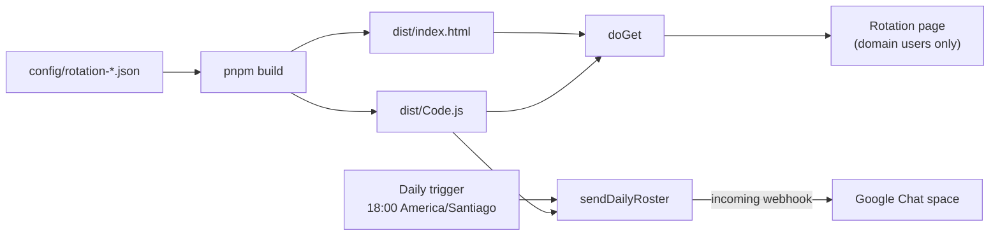

# Weekly Roster

A Google Apps Script web app that shows the team's 4-week office rotation and posts the next
working day's assignment to a Google Chat space every weekday at 18:00 (America/Santiago).



## Getting started

Needs Node 20+ and pnpm.

```sh
pnpm install
pnpm run dev
```

`pnpm run dev` serves the page at <http://localhost:5173>. The page has no server calls: the
rotation is bundled at build time, so it runs locally exactly as it does on Apps Script.

## Environments

One Apps Script project (`.clasp.json`) serves both environments. Both URLs need a signed-in
account on the company Google Workspace domain.

| Environment | Deployment                       | URL                                                                 |
| ----------- | -------------------------------- | ------------------------------------------------------------------- |
| dev         | `@HEAD`: the latest `clasp push` | the `/dev` URL in `pnpm exec clasp list-deployments` (editors only) |
| prod        | the single stable deployment     | the `/exec` URL in `pnpm exec clasp list-deployments`               |

The daily trigger always runs the latest pushed code (`@HEAD`), not the stable deployment. A
`clasp push` from a branch changes the 18:00 message until `main` is pushed again.

## Configuration

### Rotation

The rotation lives in `config/*.json`. `src/shared/config.ts` imports the active file (today
`config/rotation-1-day.json`); to switch, change that import and release.

| Field        | Purpose                                                                                      |
| ------------ | -------------------------------------------------------------------------------------------- |
| `timezone`   | IANA timezone for "today" and the trigger (`America/Santiago`)                               |
| `anchorDate` | `YYYY-MM-DD` Monday that starts week type 1                                                  |
| `user`       | Member highlighted by default on the page                                                    |
| `weekdays`   | Column names, Monday first (`Lunes` … `Viernes`)                                             |
| `schedule`   | Exactly 4 weeks: `{ "week": n, "days": { "<weekday>": "<assignment>" } }`; `""` means nobody |

The week type is the number of calendar weeks since `anchorDate`, modulo 4.

### Script Properties

Set them in the Apps Script editor → Project Settings → Script Properties. Never commit their values.

| Name               | Purpose                                                                                                         | Required | Default                                                        |
| ------------------ | --------------------------------------------------------------------------------------------------------------- | -------- | -------------------------------------------------------------- |
| `CHAT_WEBHOOK_URL` | Incoming webhook of the Google Chat space that gets the daily message. Secret: it lets anyone post to the space | Yes      | none; the run fails                                            |
| `ROSTER_PAGE_URL`  | Link in the message. Set it to the prod `/exec` URL                                                             | No       | `ScriptApp.getService().getUrl()`, which may be the `/dev` URL |

### Manifest

`appsscript.json`: timezone `America/Santiago`, V8, web app access `DOMAIN`, executed as the
deploying user, scopes `script.external_request` (post to Chat) and `script.scriptapp`
(triggers).

## Development

| Command          | What it does                                                                         |
| ---------------- | ------------------------------------------------------------------------------------ |
| `pnpm test`      | Vitest unit tests (rotation and message logic)                                       |
| `pnpm typecheck` | `tsc` for the page (`tsconfig.json`) and the Apps Script code (`tsconfig.gas.json`)  |
| `pnpm lint`      | ESLint                                                                               |
| `pnpm build`     | Dual build into `dist/`: `Code.js`, a single inlined `index.html`, `appsscript.json` |

## End-to-end tests

None. After `clasp push`, check the page on the dev `/dev` URL.

## Deployment

### First time

1. Enable the Apps Script API: <https://script.google.com/home/usersettings>.
2. `pnpm exec clasp login`.
3. Only if `.clasp.json` is missing:
   `pnpm exec clasp create --type webapp --title "Weekly Roster" --rootDir dist`, then commit
   `.clasp.json`.
4. `pnpm run deploy` (build and push to `@HEAD`).
5. Create the stable deployment, **once**:
   `pnpm exec clasp create-version "v1" && pnpm exec clasp create-deployment -V 1 -d "prod"`.
6. Set the Script Properties above.
7. In the editor, run `installDailyTrigger` once and accept the permissions.

### Releasing a change

Test a branch on `@HEAD` (`pnpm run deploy`, then the `/dev` URL), open a PR, and after it
merges promote `main` to the stable deployment:

```sh
git checkout main && git pull
pnpm run deploy
pnpm exec clasp create-version "<what changed>"   # prints version N
pnpm exec clasp list-deployments                  # the one non-@HEAD id
pnpm exec clasp update-deployment <STABLE_DEPLOYMENT_ID> -V <N>
git tag vN && git push origin vN
```

Never run `create-deployment` again: it mints a new URL.

## Operations

- **Did the message go out?** Apps Script editor → Executions lists every `sendDailyRoster`
  run. A failed run (missing `CHAT_WEBHOOK_URL`, Chat rejecting the post) also emails the owner.
- **Send it by hand:** run `sendDailyRoster` in the editor. It posts to the real space, and
  sends nothing on Saturday and Sunday.
- **Change the hour:** edit `SEND_HOUR` in `src/backend/daily-roster.ts`, release, then run
  `installDailyTrigger` again. Apps Script runs it within ±15 minutes of the hour.
- **Change the rotation:** edit the config JSON and release; the page and the message both use it.
- **Known limits:** public holidays are not skipped. Any domain user who opens the page can call
  the script's top-level functions through `google.script.run`, `sendDailyRoster` included.
